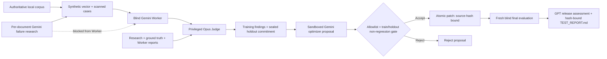
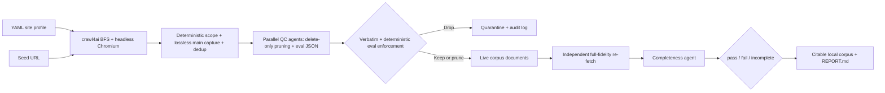

# Agent Crawler and Self-Improvement Portfolio Implementation Plan

> **For agentic workers:** REQUIRED SUB-SKILL: Use superpowers:subagent-driven-development (recommended) or superpowers:executing-plans to implement this plan task-by-task. Steps use checkbox (`- [ ]`) syntax for tracking.

**Goal:** Revise the root portfolio case study so the measured self-improving agent loop is the hero feature and the agent-enabled web crawler is its evidence foundation.

**Architecture:** Rewrite the existing two Mermaid diagrams and surrounding narrative without changing the two-diagram budget. Strengthen the focused documentation regression test so it enforces the new headings, normalized evidence phrases, crawler/loop concepts, measured facts, and resolving local links.

**Tech Stack:** GitHub-Flavored Markdown, Mermaid, Python 3.11, pytest, crawl4ai terminology, GitHub Copilot SDK terminology, existing publish-safety checker.

## Global Constraints

- The primary technical highlight is the measured self-improving agent loop.
- The agent-enabled web crawler is the source-agnostic evidence foundation.
- Keep exactly two standard fenced `mermaid` flowcharts.
- Present **11 accepted / 23 rejected** proposals and the exact non-regression acceptance rules.
- State that post-patch rerun deltas move in both directions and are monitoring evidence, not improvement credit.
- Describe the crawler as agent-enabled, not fully agentic: deterministic code owns crawling and gates; agents own bounded semantic QC and completeness review.
- Preserve first-person voice for recruiters and technical interviewers.
- Use only measurements present in tracked release evidence.
- Do not include applicant PII, private paths, credentials, raw prompts, or unpublished run artifacts.
- Describe the product as substantiation screening and guidance, not legal advice.
- Modify only `TECHNICAL_HIGHLIGHTS.md` and `crawler/tests/test_technical_highlights.py`.
- Do not change runtime code, dependencies, README content, planning files, or unrelated untracked files during implementation.

## File Structure

- Modify `TECHNICAL_HIGHLIGHTS.md` — two-pillar portfolio case study led by the self-improving loop and supported by the agent-enabled crawler.
- Modify `crawler/tests/test_technical_highlights.py` — anchored headings, whitespace-normalized evidence, crawler/loop concept requirements, Mermaid count, and local-link resolution.

---

### Task 1: Reframe the Portfolio Around the Agent Loop and Crawler

**Files:**
- Modify: `TECHNICAL_HIGHLIGHTS.md`
- Modify: `crawler/tests/test_technical_highlights.py`
- Reference: `docs/superpowers/specs/2026-07-27-agent-crawler-self-improvement-portfolio-design.md`
- Reference: `TEST_REPORT.md`
- Reference: `crawler/README.md`
- Reference: `crawler/QC_RUNBOOK.md`

**Interfaces:**
- Consumes: tracked v12.0 release evidence and the shipped crawler, optimizer, holdout, patch-gate, SDK, and orchestration implementations.
- Produces: a recruiter-readable case study and a pytest contract that fails if either flagship system, its evidence, diagrams, or local references drift.

- [ ] **Step 1: Replace the documentation contract with the stricter failing test**

Replace `crawler/tests/test_technical_highlights.py` with:

```python
from __future__ import annotations

from pathlib import Path
import re


ROOT = Path(__file__).resolve().parents[2]
HIGHLIGHTS = ROOT / "TECHNICAL_HIGHLIGHTS.md"


def _document() -> str:
    return HIGHLIGHTS.read_text(encoding="utf-8")


def _normalized(text: str) -> str:
    return " ".join(text.split())


def test_technical_highlights_has_two_pillar_portfolio_structure() -> None:
    text = _document()

    required_sections = (
        "# Technical Highlights",
        "## Project Snapshot",
        "## The Engineering Challenge",
        "## Self-Improving Agent Loop",
        "## Agent-Enabled Web Crawler",
        "## From Corpus to Applicant Review",
        "## Engineering Highlights",
        "## Reliability and Security",
        "## Measured Outcomes",
        "## What I Demonstrated",
        "## Technical References",
    )
    for section in required_sections:
        assert re.search(
            rf"^{re.escape(section)}$",
            text,
            flags=re.MULTILINE,
        ), section

    mermaid_blocks = re.findall(
        r"```mermaid\n(.*?)\n```",
        text,
        flags=re.DOTALL,
    )
    assert len(mermaid_blocks) == 2
    assert all(block.lstrip().startswith("flowchart ") for block in mermaid_blocks)


def test_technical_highlights_preserves_measured_release_facts() -> None:
    normalized = _normalized(_document())

    required_facts = (
        "23 document pipelines",
        "118 logical cases",
        "236 synthetic PDFs",
        "236 blind Worker runs",
        "23 privileged Judge runs",
        "Peak concurrency | 5",
        "11 accepted / 23 rejected",
        "2,409 passed",
        "203,795 subtests",
        "0 cleanup survivors",
    )
    for fact in required_facts:
        assert fact in normalized

    assert "rerun deltas move in both directions" in normalized
    assert "does not guarantee an immigration outcome" in normalized.lower()


def test_technical_highlights_explains_agent_enabled_crawler() -> None:
    normalized = _normalized(_document())

    required_crawler_concepts = (
        "crawl4ai",
        "source-agnostic",
        "delete-only",
        "deterministic eval enforcement",
        "full-fidelity re-fetch",
        "`pass`, `fail`, and `incomplete`",
        "five-key JSON envelope",
    )
    for concept in required_crawler_concepts:
        assert concept in normalized


def test_technical_highlights_explains_measured_improvement_loop() -> None:
    normalized = _normalized(_document())

    required_loop_concepts = (
        "sealed holdout",
        "proposal sandbox",
        "non-regression gate",
        "atomic patch",
        "11 accepted / 23 rejected",
        "Python validates and orchestrates model work",
    )
    for concept in required_loop_concepts:
        assert concept in normalized


def test_technical_highlights_local_links_resolve() -> None:
    text = _document()
    links = re.findall(r"\[[^\]]+\]\(([^)]+)\)", text)

    for link in links:
        if link.startswith(("https://", "http://", "#")):
            continue
        path = link.split("#", 1)[0]
        assert path, f"Empty local link target: {link}"
        assert (ROOT / path).exists(), f"Missing local link target: {link}"
```

- [ ] **Step 2: Run the revised contract and confirm it fails against the old case study**

Run:

```bash
.venv/bin/python -m pytest crawler/tests/test_technical_highlights.py -q
```

Expected: FAIL because the existing document lacks `## Self-Improving Agent Loop`,
`## Agent-Enabled Web Crawler`, `## From Corpus to Applicant Review`, crawler
concepts, and the `11 accepted / 23 rejected` phrase.

- [ ] **Step 3: Replace the root portfolio case study**

Replace `TECHNICAL_HIGHLIGHTS.md` with:

````markdown
# Technical Highlights

## PR Review Agents — A Self-Improving, Evidence-Grounded Agent System

I designed and built a production-oriented multi-agent system that improves its own
document-review skills against measured evidence while remaining grounded in a
locally built authoritative corpus.

The two systems that distinguish the project are:

1. a **blind, self-improving agent loop** that proposes prompt and skill changes but
   accepts them only after training improvement and sealed-holdout non-regression;
2. an **agent-enabled, source-agnostic web crawler** that combines deterministic
   browser extraction and validation with bounded semantic quality-control agents.

Together they support a Canadian Express Entry review workflow without exposing
applicant data or allowing a model to invent immigration requirements.

> This project provides document substantiation screening and guidance. It is not
> legal advice and does not guarantee an immigration outcome.

## Project Snapshot

| Area | Measured result |
|---|---:|
| Independent document pipelines | 23 |
| Synthetic evaluation dataset | 118 logical cases / 236 synthetic PDFs |
| Final model evaluation | 236 blind Worker runs / 23 privileged Judge runs |
| Optimizers and shared evaluations | 23 / 23 |
| Peak concurrency | 5 |
| Candidate skill changes | 11 accepted / 23 rejected |
| Runtime cleanup | 0 cleanup survivors / 0 cleanup errors |
| Repository validation | 2,409 passed, 8 skipped, 1 deselected |
| Generated subtest coverage | 203,795 subtests |
| Publish-safety scan | 1,584 tracked files / 0 violations |

The complete measured release evidence is published in
[`TEST_REPORT.md`](TEST_REPORT.md).

## The Engineering Challenge

This was not a conventional chatbot. It had to improve probabilistic agent behavior
without letting the agents grade themselves, see sealed evaluation data, weaken safety
rules, rewrite authoritative evidence, or convert infrastructure failures into
success-shaped results.

I designed around six constraints:

1. **Every policy claim must be provable.** Claims resolve to an exact chunk in a
   curated local corpus and include a verbatim quote. Missing evidence produces an
   explicit abstention instead of a guess.
2. **Applicant data must remain local.** Raw documents, extracted fields, and personal
   facts stay inside git-ignored candidate vaults.
3. **Claimed agent work must be real agent work.** Research, generation, review,
   judging, optimization, and release assessment run through GitHub Copilot agents;
   Python never fabricates semantic model results.
4. **Evaluation must remain blind.** Workers cannot infer why a document should fail
   from research, labels, filenames, identifiers, sibling mappings, ground truth, or
   Judge findings.
5. **Improvement must be measured.** A proposed patch must improve training results
   without regressing safety or any sealed holdout dimension.
6. **Authoritative text must remain verbatim.** Crawler QC agents may delete
   out-of-scope sections, but cannot paraphrase or rewrite retained source material.

## Self-Improving Agent Loop



Each of the 23 document types runs as an isolated pipeline. Research agents identify
common failure modes, synthetic generators create both vector and scanned document
siblings, blind Workers review neutral PDF attachments, and privileged Judges score
the reports against private ground truth.

The isolation is structural:

- Workers receive no research, failure labels, revealing filenames, case identifiers,
  sibling mappings, ground truth, or Judge findings.
- Judges receive the privileged evidence required for complete case evaluation.
- Optimizers receive training findings only. Holdout scores and findings stay behind a
  sealed holdout commitment.
- Optimizer output is written to a proposal sandbox, not shared source.

Python validates and orchestrates model work but never creates semantic findings,
scores, research, or patches on a model's behalf.

### The acceptance gate

A candidate patch is path-allowlisted, scanned for PII and privileged-data leakage,
bounded by diff size, and evaluated before application. It is accepted only when:

- training overall score improves by more than the numeric tolerance;
- training grounding, citation exactness, PII containment, and blind-input compliance
  do not regress;
- every sealed holdout dimension remains non-regressing.

Only then does the parent apply an atomic patch using a compare-and-swap source hash
and commit it individually. The measured pipeline accepted 11 proposals and rejected
23: **11 accepted / 23 rejected**.

Shared-baseline and final-rerun evaluations execute independently against the same
post-patch source. Their rerun deltas move in both directions and are monitoring
evidence, not improvement credit.

## Agent-Enabled Web Crawler



The crawler is deliberately **agent-enabled, not fully agentic**. Deterministic Python
owns browser execution, domain boundaries, URL filtering, `<main>` extraction, chrome
removal, classification, URL and content-hash deduplication, manifests, verdict
application, JSON contracts, and final status.

Agents operate only where semantic judgment adds value:

1. Crawled Markdown files are partitioned into disjoint sets for parallel QC agents.
2. QC uses a delete-only rule: agents may remove complete out-of-scope sections or
   boilerplate, but may never rewrite retained authoritative text.
3. Each agent writes a per-document eval contract containing relevance, verdict,
   `must_contain`, `must_not_contain`, and grounding references.
4. A byte-preservation check catches altered retained lines, while deterministic eval
   enforcement rejects invalid contracts.
5. Drop-verdict pages are moved into quarantine with an audit log rather than silently
   deleted.
6. An independent full-fidelity re-fetch samples live pages so a completeness agent can
   detect substantive content that browser extraction or QC missed.

The final report distinguishes `pass`, `fail`, and `incomplete`, preventing missing
completeness evidence from appearing as success.

The crawler is source-agnostic through YAML site profiles. Any supported CLI agent can
drive it through ordinary shell commands and a portable five-key JSON envelope:
`schema_version`, `ok`, `command`, `result`, and `error`.

## From Corpus to Applicant Review

The root workflow connects both pillars. A user can start an agent at the repository
root and ask, "I want to review X." The coordinator imports the document into a
git-ignored candidate vault, asks the user to confirm uncertain extracted fields, and
dispatches the matching document and CRS agents.

Those agents consume:

- exact, citable source chunks produced by the crawler;
- document skills improved by the measured self-improvement loop;
- private applicant facts that remain structurally separate from public claims.

The fail-closed grounding gate verifies every policy claim and verbatim quote before
private remediation guidance or a redacted professional review packet is produced.

## Engineering Highlights

### Measured improvement instead of self-scoring

The optimizer cannot see holdout findings and cannot apply its own changes. A
privileged Judge produces scores, deterministic code seals holdout data, the optimizer
proposes a candidate in a sandbox, and the parent independently evaluates and applies
only non-regressing improvements.

### Hybrid deterministic and agentic crawler

The crawler assigns semantic scope review and completeness comparison to agents while
keeping navigation, extraction, deduplication, byte preservation, contract enforcement,
quarantine, and release status deterministic. This makes agent judgment useful without
making corpus integrity dependent on prompt compliance.

### Official GitHub Copilot SDK runtime

I replaced hardcoded and subprocess-shaped model simulations with a typed adapter over
`github-copilot-sdk`. Blind sessions use explicit models and context settings with
`mode="empty"` and `available_tools=[]`, removing skills, MCP tools, memory,
repository discovery, and host-tool access.

The runtime distinguishes authentication, deterministic validation, timeout,
transport, and transient provider failures. A model receives at most one sanitized
same-session structural correction; Python never edits its semantic assessment.

### Supervised five-pipeline execution

The supervisor owns a repository-wide lease and runs exactly five document children at
a time. Every child is registered using its PID, process start time, post-exec command
digest, run ID, and parent ownership.

A stalled SDK child can therefore be terminated without touching the interactive
Copilot process or another workload. Cleanup never uses name-based process killing,
and the lease is retained when descendant ownership or reaping cannot be proven.

### Tamper-resistant release evidence

The release pipeline persists sanitized evidence, validated raw model JSON, SDK
provenance, deterministic Markdown, and a cross-linked SHA-256 manifest. Validators
recompute coverage, patch ordering, model assignments, lifecycle counts, source
inventories, and cryptographic bindings from committed artifacts.

## Reliability and Security

| Risk | Engineering control |
|---|---|
| Crawler escapes source scope | YAML profile, allowed domains, include glob, BFS filters |
| Authoritative text is rewritten | Delete-only QC plus byte-preservation gate |
| Browser silently truncates content | Independent full-fidelity re-fetch and completeness agent |
| Invalid corpus is published | Deterministic eval enforcement and `pass` / `fail` / `incomplete` report |
| Worker learns failure reason | Opaque attachments, no privileged IDs, paths, research, or tools |
| Optimizer overfits evaluation | Sealed holdout findings and independent non-regression gate |
| Unsafe prompt patch | Target allowlist, leakage scan, diff bound, source-hash CAS, atomic commit |
| Fake model provenance | Official SDK session records and strict model/runtime/protocol bindings |
| Stalled or wrong process cleanup | Typed deadlines and exact PID/start-time/command-digest ownership |
| Applicant PII leakage | Git-ignored vaults, structural claim/basis separation, publish-safety scans |
| Evidence tampering | Strict schemas, recomputation, SHA-256 manifests, committed-only validation |

The shipped run reconciled 93 of 93 registered processes with zero survivors and zero
cleanup errors. Security, evaluation, integration, code, documentation, and milestone
audits passed before the v12.0 release was tagged.

## Measured Outcomes

The final benchmark completed all 23 document pipelines and all 236 blind Worker runs.
Each document type received one privileged Judge evaluation, one optimizer pass, one
shared evaluation, and a fresh final evaluation.

The gate accepted 11 targeted skill improvements and rejected 23 candidates that did
not satisfy the measured acceptance criteria. Accepted changes covered digital photos,
employment reference letters, letters of explanation, marriage certificates, medical
examinations, proof of other names, and proof of studies.

The strongest recorded training gain was +0.1333 for the first Letter of Explanation
refinement, with a +0.1100 holdout delta.

Release validation included:

- 742 Phase 74 tests and 200,371 generated subtests;
- 83 strict live-conformance tests;
- 140 coordinated tamper tests;
- 29 Phase 75 release tests;
- 2,409 passed repository tests and 203,795 subtests;
- a 1,584-file publish-safety scan with zero violations;
- an independent GPT-5.6 Sol `xhigh` release verdict of `ready`.

## What I Demonstrated

- **AI systems engineering:** converted agent behavior into explicit, testable runtime,
  isolation, evidence, and acceptance contracts.
- **Self-improving systems:** built a genuine propose-evaluate-gate-apply loop with
  sealed holdouts, independent Judges, rejected candidates, and measured deltas.
- **Agent-enabled data engineering:** combined browser crawling, source profiles,
  bounded semantic QC, deterministic evals, completeness sampling, and corpus reports.
- **Distributed orchestration:** designed leases, heartbeats, process identity,
  concurrency bounds, timeouts, and targeted cleanup for parallel SDK workloads.
- **Security and privacy engineering:** enforced local PII containment, least-privilege
  model sessions, blind evaluation, publish safety, and fail-closed defaults.
- **Backend engineering:** implemented typed Python APIs, Pydantic validation, atomic
  persistence, deterministic JSON envelopes, CLI workflows, and corpus indexing.
- **Release engineering:** required independent goal, integration, code, security,
  evaluation, documentation, and milestone audits before shipping.

## Technical References

- Measured release evidence: [`TEST_REPORT.md`](TEST_REPORT.md)
- System contract and root workflow: [`AGENTS.md`](AGENTS.md)
- Source-agnostic crawler:
  [`crawler/deepcrawl.py`](crawler/deepcrawl.py)
- Agent QC and completeness runbook:
  [`crawler/QC_RUNBOOK.md`](crawler/QC_RUNBOOK.md)
- Deterministic eval enforcement:
  [`crawler/eval_runner.py`](crawler/eval_runner.py)
- Verdict quarantine:
  [`crawler/apply_verdicts.py`](crawler/apply_verdicts.py)
- Full-fidelity completeness re-fetch:
  [`crawler/completeness.py`](crawler/completeness.py)
- Portable crawler agent contract:
  [`crawler/AGENT_SKILL.md`](crawler/AGENT_SKILL.md)
- Sandboxed optimizer:
  [`crawler/eval/genuine_optimizer.py`](crawler/eval/genuine_optimizer.py)
- Holdout splitter and sealer:
  [`crawler/eval/holdout_splitter.py`](crawler/eval/holdout_splitter.py)
- Patch allowlist and non-regression gate:
  [`crawler/eval/patch_evaluator.py`](crawler/eval/patch_evaluator.py)
- Five-process SDK supervisor:
  [`crawler/eval/sdk_pipeline_orchestrator.py`](crawler/eval/sdk_pipeline_orchestrator.py)
- Official SDK lifecycle adapter:
  [`crawler/eval/copilot_sdk_runtime.py`](crawler/eval/copilot_sdk_runtime.py)
````

- [ ] **Step 4: Run the focused regression test**

Run:

```bash
.venv/bin/python -m pytest crawler/tests/test_technical_highlights.py -q
```

Expected: `5 passed`.

- [ ] **Step 5: Run publication and formatting checks**

Run:

```bash
.venv/bin/python scripts/check_publish_safe.py
git --no-pager diff --check -- TECHNICAL_HIGHLIGHTS.md crawler/tests/test_technical_highlights.py
```

Expected:

- publish-safety exits `0` with zero violations;
- `git diff --check` emits no output.

- [ ] **Step 6: Inspect the exact scoped diff**

Run:

```bash
git --no-pager diff -- TECHNICAL_HIGHLIGHTS.md crawler/tests/test_technical_highlights.py
```

Expected: only the portfolio case study and its focused regression test are modified.

- [ ] **Step 7: Commit the implementation**

```bash
git add -- TECHNICAL_HIGHLIGHTS.md crawler/tests/test_technical_highlights.py
git commit -m "docs: highlight agent crawler and improvement loop" \
  -m "Co-authored-by: Copilot <223556219+Copilot@users.noreply.github.com>"
```

