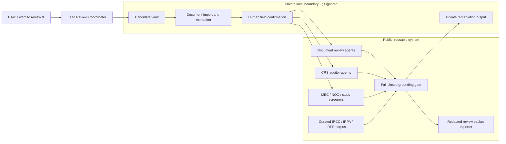
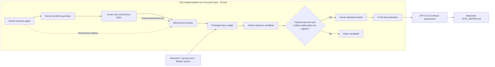

# Technical Highlights Portfolio Case Study Implementation Plan

> **For agentic workers:** REQUIRED SUB-SKILL: Use superpowers:subagent-driven-development (recommended) or superpowers:executing-plans to implement this plan task-by-task. Steps use checkbox (`- [ ]`) syntax for tracking.

**Goal:** Publish a root-level, first-person portfolio case study with GitHub-rendered Mermaid diagrams and evidence-backed engineering results.

**Architecture:** Add one standalone Markdown case study at the repository root and one focused regression test that verifies the document's required sections, Mermaid blocks, measured facts, and local links. The document will describe the production review workflow and the blind self-improvement pipeline without changing runtime behavior.

**Tech Stack:** GitHub-Flavored Markdown, Mermaid, Python 3.11, pytest, existing publish-safety checker.

## Global Constraints

- Output path is exactly `TECHNICAL_HIGHLIGHTS.md`.
- Use first-person voice and address both recruiters and technical interviewers.
- Use only measurements present in tracked release evidence.
- Include exactly two standard fenced `mermaid` blocks supported by GitHub Markdown.
- Do not present shared-baseline versus final-rerun variance as self-improvement.
- Present the 11 accepted patches as measured, non-regressing improvements.
- Do not include applicant PII, private paths, credentials, raw prompts, or unpublished run artifacts.
- Describe the system as substantiation screening and guidance, not legal advice.
- Do not modify runtime code, dependencies, README content, or unrelated untracked files.

## File Structure

- Create `TECHNICAL_HIGHLIGHTS.md` — recruiter-readable project case study, architecture diagrams, engineering depth, measured outcomes, and source references.
- Create `crawler/tests/test_technical_highlights.py` — structural contract for required sections, Mermaid syntax shape, release metrics, variance wording, and local reference links.

---

### Task 1: Publish and Protect the Portfolio Case Study

**Files:**
- Create: `TECHNICAL_HIGHLIGHTS.md`
- Create: `crawler/tests/test_technical_highlights.py`
- Reference: `docs/superpowers/specs/2026-07-27-technical-highlights-design.md`
- Reference: `TEST_REPORT.md`
- Reference: `AGENTS.md`

**Interfaces:**
- Consumes: committed project evidence and implementation links already present in the repository.
- Produces: a GitHub-renderable portfolio document and a pytest contract that fails if its required evidence, diagrams, or links drift.

- [ ] **Step 1: Write the failing document contract**

Create `crawler/tests/test_technical_highlights.py`:

```python
from __future__ import annotations

from pathlib import Path
import re


ROOT = Path(__file__).resolve().parents[2]
HIGHLIGHTS = ROOT / "TECHNICAL_HIGHLIGHTS.md"


def _document() -> str:
    return HIGHLIGHTS.read_text(encoding="utf-8")


def test_technical_highlights_has_required_portfolio_structure() -> None:
    text = _document()

    required_sections = (
        "# Technical Highlights",
        "## Project Snapshot",
        "## The Engineering Challenge",
        "## Production Architecture",
        "## Blind Self-Improvement Pipeline",
        "## Engineering Highlights",
        "## Reliability and Security",
        "## Measured Outcomes",
        "## What I Demonstrated",
        "## Technical References",
    )
    for section in required_sections:
        assert section in text

    mermaid_blocks = re.findall(
        r"```mermaid\n(.*?)\n```",
        text,
        flags=re.DOTALL,
    )
    assert len(mermaid_blocks) == 2
    assert all(block.lstrip().startswith("flowchart ") for block in mermaid_blocks)


def test_technical_highlights_preserves_measured_release_facts() -> None:
    text = _document()

    required_facts = (
        "23 document pipelines",
        "118 logical cases",
        "236 synthetic PDFs",
        "236 blind Worker runs",
        "23 privileged Judge runs",
        "Peak concurrency | 5",
        "11 accepted improvements",
        "2,409 passed",
        "203,795 subtests",
        "0 cleanup survivors",
    )
    for fact in required_facts:
        assert fact in text

    assert "rerun variance is not an improvement measurement" in text
    assert "does not guarantee an immigration outcome" in text.lower()


def test_technical_highlights_local_links_resolve() -> None:
    text = _document()
    links = re.findall(r"\[[^\]]+\]\(([^)]+)\)", text)

    for link in links:
        if link.startswith(("https://", "http://", "#")):
            continue
        path = link.split("#", 1)[0]
        assert path, f"Empty local link target: {link}"
        assert (ROOT / path).exists(), f"Missing local link target: {link}"
```

- [ ] **Step 2: Run the document contract and confirm it fails**

Run:

```bash
.venv/bin/python -m pytest crawler/tests/test_technical_highlights.py -q
```

Expected: FAIL because `TECHNICAL_HIGHLIGHTS.md` does not exist.

- [ ] **Step 3: Write the portfolio case study**

Create `TECHNICAL_HIGHLIGHTS.md` with this content:

````markdown
# Technical Highlights

## PR Review Agents — A Grounded, Privacy-First Multi-Agent Review System

I designed and built a production-oriented multi-agent system that helps Canadian
Express Entry applicants review supporting documents, substantiate CRS claims, screen
policy edge cases, and prepare remediation material without exposing applicant data or
allowing an AI model to invent immigration requirements.

The project combines deterministic Python tooling with real GitHub Copilot SDK agents.
It treats grounding, privacy, model isolation, process ownership, evaluation evidence,
and release readiness as enforceable software contracts rather than prompt-level
suggestions.

> This project provides document substantiation screening and guidance. It is not
> legal advice and does not guarantee an immigration outcome.

## Project Snapshot

| Area | Measured result |
|---|---:|
| Independent document pipelines | 23 |
| Synthetic evaluation dataset | 118 logical cases / 236 synthetic PDFs |
| Final model evaluation | 236 blind Worker runs / 23 privileged Judge runs |
| Optimizers and shared evaluations | 23 / 23 |
| Peak concurrency | 5 |
| Accepted self-improvements | 11 accepted improvements |
| Runtime cleanup | 0 cleanup survivors / 0 cleanup errors |
| Repository validation | 2,409 passed, 8 skipped, 1 deselected |
| Generated subtest coverage | 203,795 subtests |
| Publish-safety scan | 1,584 tracked files / 0 violations |

The complete measured release evidence is published in
[`TEST_REPORT.md`](TEST_REPORT.md).

## The Engineering Challenge

This was not a conventional chatbot. The system operates in a domain where a plausible
but unsupported answer can mislead a user, and where uploaded documents contain highly
sensitive personal information.

I designed around five constraints:

1. **Every policy claim must be provable.** Claims resolve to an exact chunk in a
   curated local corpus and include a verbatim quote. Missing evidence produces an
   explicit abstention instead of a guess.
2. **Applicant data must remain local.** Raw documents, extracted fields, and personal
   facts stay inside git-ignored candidate vaults and never enter public claim strings
   or publishable evidence.
3. **Claimed agent work must be real agent work.** Research, generation, review,
   judging, optimization, and release assessment use the official GitHub Copilot SDK;
   Python validates outputs but never fabricates semantic model results.
4. **Evaluation must remain blind.** Worker agents cannot infer why a document should
   fail from research, labels, filenames, case identifiers, sibling mappings, or
   ground-truth artifacts.
5. **Failures must fail closed.** Ambiguous process ownership, malformed evidence,
   grounding failure, PII leakage, incomplete case coverage, or uncertain cleanup
   blocks the affected stage instead of producing a success-shaped fallback.

## Production Architecture



The root [`AGENTS.md`](AGENTS.md) file is the canonical cross-CLI contract. It defines
the four-stage workflow, strict JSON envelope, grounding schema, PII partition, agent
roles, and fail-closed behavior used by GitHub Copilot, Claude Code, Codex, Cursor,
Windsurf, and Antigravity adapters.

## Blind Self-Improvement Pipeline



Each document type runs in an independent child process and isolated SDK directory.
Five pipelines can run concurrently, but model sessions inside each pipeline remain
sequential. This preserves a strict global concurrency bound while preventing one
document type from reading another pipeline's private artifacts or corrupting its
state.

The Worker sees only the public review bundle and an opaque PDF attachment. The
privileged Judge sees the research, private ground truth, PDFs, and Worker reports
needed to score complete case coverage. The optimizer receives training findings, but
sealed holdout results remain outside its context.

## Engineering Highlights

### Official GitHub Copilot SDK runtime

I replaced hardcoded and subprocess-shaped model simulations with a typed runtime
adapter over `github-copilot-sdk`. Sessions use explicit model, effort, and context
configuration; `mode="empty"` and `available_tools=[]` remove skills, MCP tools,
memory, repository discovery, and host-tool access from blind model sessions.

The runtime classifies authentication, deterministic validation, timeout, transport,
and transient provider failures separately. A model can receive at most one sanitized
same-session correction for structural output; Python never edits the model's semantic
assessment.

### Supervised five-pipeline execution

The Phase 74 supervisor owns a repository-wide lease and runs exactly five document
children at a time. Every child is registered using its PID, process start time,
post-exec command digest, run ID, and parent ownership.

This solved a difficult operational problem: a stalled SDK child can be terminated
without touching the interactive Copilot process or another user's workload. Cleanup
never uses name-based process killing, and the lease is retained when descendant
ownership or reaping cannot be proven.

### Deterministic contracts around probabilistic models

All model boundaries use strict Pydantic schemas with unknown fields forbidden.
Outputs are validated for JSON structure, complete case coverage, grounding,
verbatim citation accuracy, PII containment, blindness, finite metrics, and source
hash consistency.

The models produce semantic work. Deterministic Python code controls orchestration,
validation, aggregation, persistence, and release decisions.

### Measured, non-regressing self-improvement

Candidate skill patches are path-allowlisted, source-hash bound, evaluated before
application, and committed atomically. A patch is accepted only when:

- training overall score improves;
- grounding, citation exactness, PII containment, and blind-input compliance do not
  regress;
- every holdout dimension remains non-regressing.

The final evidence records 11 accepted improvements with positive training deltas and
non-negative holdout deltas. Shared-baseline and final-rerun scores are independent
post-patch evaluations of the same source, so rerun variance is not an improvement
measurement.

### Tamper-resistant release evidence

The release pipeline persists sanitized evidence, validated raw model JSON, SDK
provenance, deterministic Markdown, and a cross-linked hash manifest. Evidence
validators recompute document coverage, patch ordering, model assignments, process
lifecycle counts, source inventories, and cryptographic bindings from committed
artifacts.

This makes the final report reproducible without trusting ignored run directories,
private candidate data, or a model-authored measurement.

## Reliability and Security

| Risk | Engineering control |
|---|---|
| Unsupported policy advice | Exact local corpus citation, verbatim quote, and explicit abstention |
| Applicant PII leakage | Git-ignored vaults, structural claim/basis separation, PII scans |
| Worker learns failure reason | Opaque attachments, no revealing IDs or paths, no tools or repository access |
| Fake model provenance | Official SDK session records and strict model/runtime/protocol bindings |
| Infinite retry or stalled cleanup | Typed retry classes, stage deadlines, bounded correction, 30-second cleanup bound |
| Wrong process terminated | Exact PID/start-time/command-digest ownership; no name-based kills |
| Unsafe prompt patch | Target allowlist, compare-and-swap source hash, holdout/safety gate, atomic commit |
| Evidence tampering | Strict schemas, SHA-256 manifests, recomputation, committed-only validation |
| Public repository leakage | Publish-safety scan across tracked files |

The shipped run reconciled 93 of 93 registered processes with zero survivors and zero
cleanup errors. Security, evaluation, integration, code, documentation, and milestone
audits all passed before the v12.0 release was tagged.

## Measured Outcomes

The final benchmark completed all 23 document pipelines and all 236 blind Worker runs.
Each document type received one privileged Judge evaluation, one optimizer pass, one
shared evaluation, and a fresh final evaluation.

The accepted patch set improved document agents including digital photos, employment
reference letters, letters of explanation, marriage certificates, medical
examinations, proof of other names, and proof of studies. The strongest single
recorded training gain was +0.1333 for the first Letter of Explanation refinement,
with a +0.1100 holdout delta.

Release validation included:

- 742 Phase 74 tests and 200,371 generated subtests;
- 83 strict live-conformance tests;
- 140 coordinated tamper tests;
- 29 Phase 75 release tests;
- 2,409 passed repository tests and 203,795 subtests;
- a 1,584-file publish-safety scan with zero violations;
- an independent GPT-5.6 Sol `xhigh` release verdict of `ready`.

## What I Demonstrated

- **AI systems engineering:** converted model behavior into explicit, testable runtime
  contracts instead of relying on prompt compliance.
- **Distributed orchestration:** designed leases, heartbeats, process identity,
  concurrency bounds, timeouts, and targeted cleanup for parallel SDK workloads.
- **Security and privacy engineering:** enforced local PII containment, least-privilege
  model sessions, blindness boundaries, publish-safety, and fail-closed defaults.
- **Evaluation engineering:** built synthetic vector/scanned datasets, privileged
  Judges, sealed holdouts, non-regression gates, tamper tests, and reproducible evidence.
- **Backend engineering:** implemented typed Python APIs, Pydantic validation, atomic
  persistence, deterministic JSON envelopes, CLI workflows, and corpus indexing.
- **Release engineering:** required independent goal, integration, code, security,
  evaluation, documentation, and milestone audits before shipping.
- **Developer experience:** made the full workflow accessible from a natural-language
  request at the repository root while preserving deterministic local tooling.

## Technical References

- System contract and operational workflow: [`AGENTS.md`](AGENTS.md)
- User onboarding and architecture: [`README.md`](README.md)
- Measured release evidence: [`TEST_REPORT.md`](TEST_REPORT.md)
- Official SDK lifecycle adapter:
  [`crawler/eval/copilot_sdk_runtime.py`](crawler/eval/copilot_sdk_runtime.py)
- Five-process supervisor:
  [`crawler/eval/sdk_pipeline_orchestrator.py`](crawler/eval/sdk_pipeline_orchestrator.py)
- Per-document state machine:
  [`crawler/eval/document_pipeline.py`](crawler/eval/document_pipeline.py)
- Committed evidence validator:
  [`crawler/eval/phase74_evidence.py`](crawler/eval/phase74_evidence.py)
- GPT release orchestrator:
  [`crawler/eval/release_orchestrator.py`](crawler/eval/release_orchestrator.py)
- Blind Worker isolation tests:
  [`crawler/tests/test_phase74_worker_isolation.py`](crawler/tests/test_phase74_worker_isolation.py)
- Coordinated tamper tests:
  [`crawler/tests/test_phase74_committed_evidence.py`](crawler/tests/test_phase74_committed_evidence.py)
- Release and root-workflow tests:
  [`crawler/tests/test_phase75_release.py`](crawler/tests/test_phase75_release.py)
  and [`crawler/tests/test_root_agent_workflow.py`](crawler/tests/test_root_agent_workflow.py)
````

- [ ] **Step 4: Run the focused regression test**

Run:

```bash
.venv/bin/python -m pytest crawler/tests/test_technical_highlights.py -q
```

Expected: `3 passed`.

- [ ] **Step 5: Run publication and formatting checks**

Run:

```bash
.venv/bin/python scripts/check_publish_safe.py
git --no-pager diff --check -- TECHNICAL_HIGHLIGHTS.md crawler/tests/test_technical_highlights.py
```

Expected:

- publish-safety exits `0` with zero violations;
- `git diff --check` emits no output.

- [ ] **Step 6: Inspect the exact scoped diff**

Run:

```bash
git --no-pager diff -- TECHNICAL_HIGHLIGHTS.md crawler/tests/test_technical_highlights.py
```

Expected: only the portfolio case study and its regression test are present.

- [ ] **Step 7: Commit the implementation**

```bash
git add -- TECHNICAL_HIGHLIGHTS.md crawler/tests/test_technical_highlights.py
git commit -m "docs: add portfolio technical highlights" \
  -m "Co-authored-by: Copilot <223556219+Copilot@users.noreply.github.com>"
```
